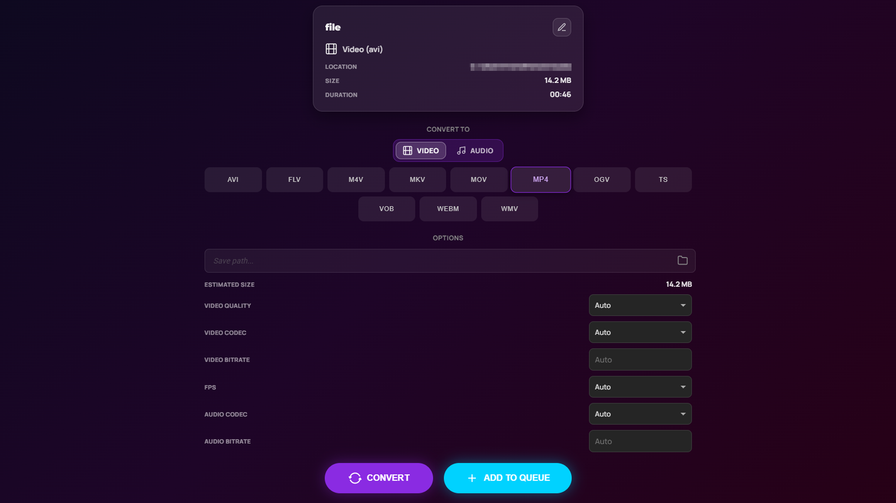
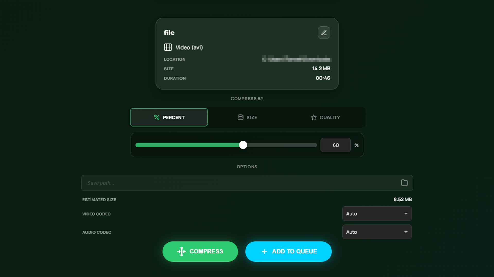

<p align="center">
  
</p>

<h3 align="center">Fast and modern media manager.</h3>

<p align="center">
  
</p>

<p align="center">
  
</p>

---

## Features
- Add downloads to a queue, start multiple processes at once, and follow their progress while they run in the background.
- Choose video or audio formats, quality, and bitrate. You can also embed metadata and thumbnails.
- Convert and compress media, or extract audio from a video.
- Pulsar downloads and sets up **Pulsar Bridge**, its JSON-based yt-dlp wrapper, and **FFmpeg** for you.
- Runs on **Windows**, **macOS**, and **Linux**.
- Choose a light or dark theme, and set your language.

## How it works
Pulsar gives you a GUI for **yt-dlp** and **FFmpeg**. Paste a URL, choose your options, and add the job to the queue. Pulsar handles the work in the background and shows progress, download speed, remaining time, and errors.
FFmpeg also powers the conversion tools, so you can change formats, compress files, extract audio, and embed metadata without using the command line.

## Installation
Download the latest release from the [Releases page](https://github.com/fuzjajadrowa/Pulsar/releases), then follow the instructions for your platform.

### Windows (x86_64)
- **Installer (.exe):** Run the NSIS installer and follow the instructions.
- **Portable (.zip):** Extract the archive and run `Pulsar.exe`.

### macOS (Apple Silicon / aarch64)
- **Installer (.pkg):** Open the package and follow the installation steps.
- **Portable (.app.tar.gz):** Extract the archive and open `Pulsar.app`. 
  - If macOS says the app is damaged, click Cancel, then go to Settings - Privacy & Security, scroll down, and click Open Anyway.

### Linux (x86_64)
- **Debian/Ubuntu (.deb):** Install the downloaded package with:
- 
  ```bash
  sudo apt install ./Pulsar-X.X.X-Linux.deb
  ```

- **Flatpak:** Install from Flathub (aarch64 builds are also available):

  ```bash
  flatpak install flathub pl.fuzjajadrowa.pulsar
  ```

  If you haven't added Flathub yet:

  ```bash
  flatpak remote-add --if-not-exists flathub https://flathub.org/repo/flathub.flatpakrepo
  ```
  
## Building from Source
To build Pulsar yourself, ensure you have **Node.js (v20+)** and the **Rust stable** toolchain installed.
1. Install OS Dependencies
   * Windows / macOS: Usually no extra system packages are required beyond build tools (C++ build tools / Xcode Command Line Tools).
   * Linux (Ubuntu/Debian):
   ```bash
   sudo apt-get update
   sudo apt-get install -y libgtk-3-dev libwebkit2gtk-4.1-dev libayatana-appindicator3-dev librsvg2-dev patchelf
   ```
2. Clone the repository
```bash
git clone https://github.com/fuzjajadrowa/Pulsar.git

cd Pulsar
```
3. Install deps
```bash
  npm install
```
4. Build the application
To compile a release build of the application:
  ```bash
    npx tauri build
  ```
The compiled binaries will be located in `src-tauri/target/release/bundle/`.
If you just want to run the app in development mode, use:
  ```bash
    npx tauri dev
  ```

## Screenshots
<table align="center">
  <tr>
    <td align="center"></td>
    <td align="center"></td>
  </tr>
  <tr>
    <td align="center"><sub>Home</sub></td>
    <td align="center"><sub>Downloader</sub></td>
  </tr>
  <tr>
    <td align="center"></td>
    <td align="center"></td>
  </tr>
  <tr>
    <td align="center"><sub>Converter</sub></td>
    <td align="center"><sub>Compressor</sub></td>
  </tr>
</table>

## License and credits
This project is licensed under the **GPL-3.0** described in the **LICENSE** file.

French translation by Zetsukae.

Powered by [Tauri](https://v2.tauri.app/), [yt-dlp](https://github.com/yt-dlp/yt-dlp), and [FFmpeg](https://ffmpeg.org/).